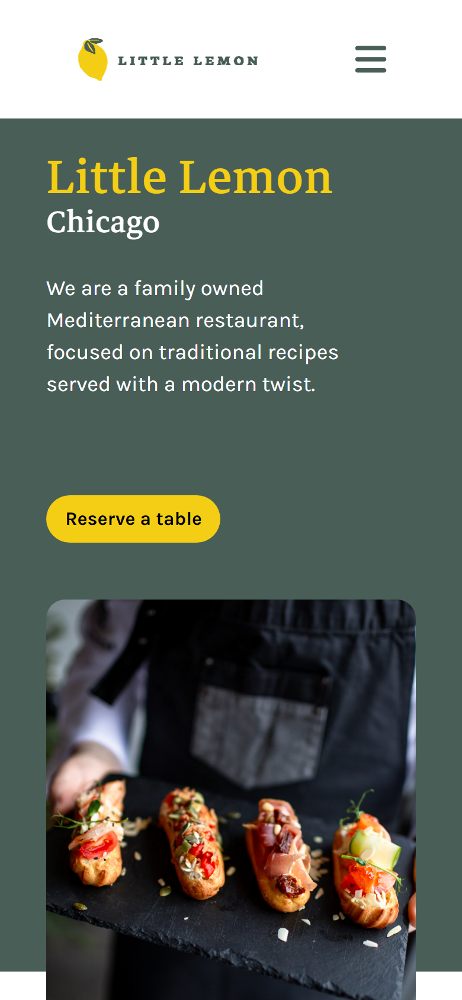
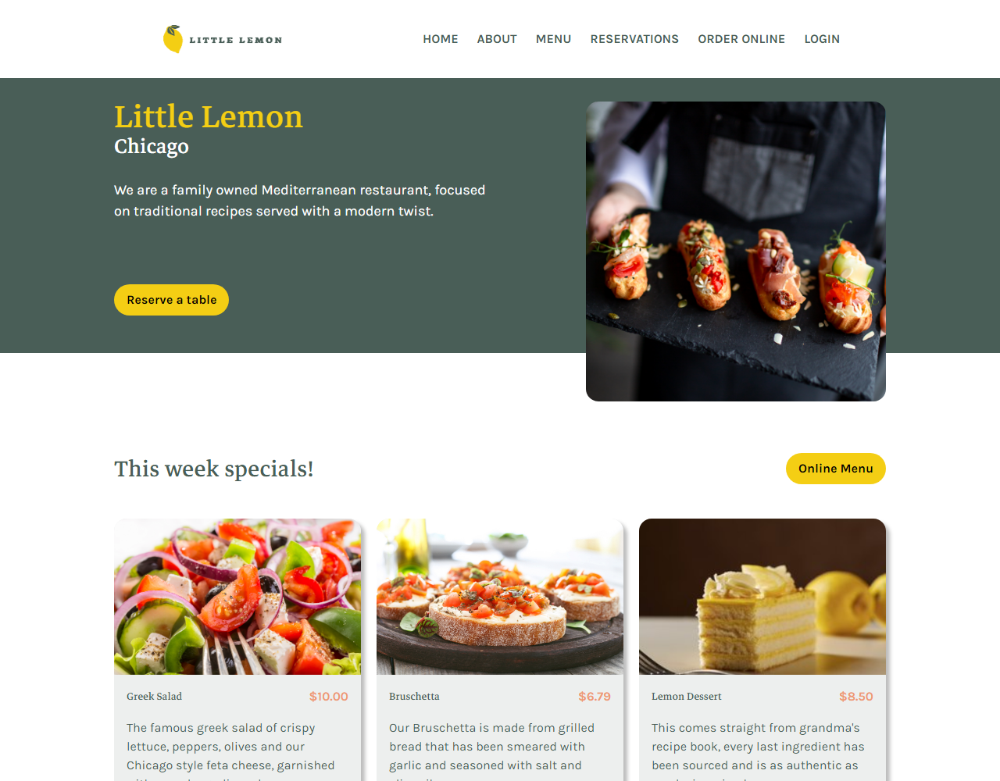
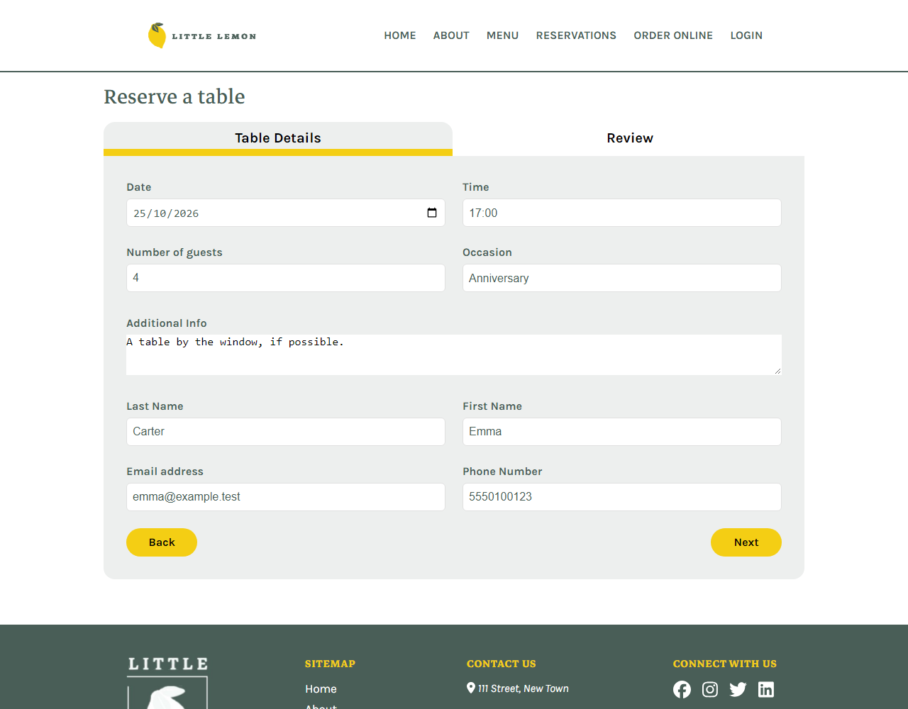
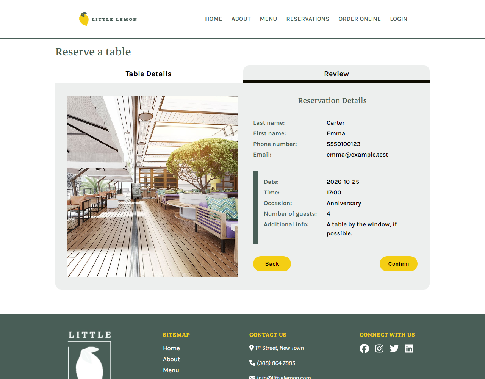

<div align="center">

# Little Lemon — Table Reservation

**A responsive website for a Mediterranean restaurant in Chicago, with a two-step online table reservation form.**

<br>

<p>
  
  
  
  
  
  
</p>

<br>

[](LICENCE.txt)

[Live Demo](https://pnsts.github.io/TableReservation/) · [Features](#key-features) · [Screenshots](#screenshots) · [Tech Stack](#technology-stack) · [Getting Started](#getting-started) · [Testing](#testing)

</div>

## Overview

Little Lemon is the fictional restaurant of the **Meta Front-End Developer Professional Certificate** capstone project. Guests browse the restaurant's home page and **book a table online**: they choose a date, time and party size, enter their details, review the booking and confirm it.

It is a single-page React application, designed first in [Figma](https://www.figma.com/design/Vb2JcJAfpz6Hfz9AGhFB2T/Table_Reservation_Website?node-id=30-45&p=f&t=0JMTGNtgIxtekZDy-0) (wireframe and prototype) and deployed to GitHub Pages. Available times come from a mock API in the browser; there is no backend.

## Key Features

<table>
<tr>
<td width="50%">📅 <b>Two-step reservation</b><br>Table details first, then a review of the booking before it is confirmed.</td>
<td width="50%">🕒 <b>Times per date</b><br>The time list refreshes whenever the guest picks another date.</td>
</tr>
<tr>
<td width="50%">✅ <b>Inline validation</b><br>Errors appear as fields are left, and Next stays disabled until every field is valid.</td>
<td width="50%">📱 <b>Responsive layout</b><br>The layout adapts from desktop to phone, with a hamburger menu on small screens.</td>
</tr>
<tr>
<td width="50%">🍋 <b>Weekly specials</b><br>Dish cards with photo, price and description on the home page.</td>
<td width="50%">⭐ <b>Testimonials</b><br>Guest reviews with full and half-star ratings.</td>
</tr>
<tr>
<td width="50%">🧭 <b>Section navigation</b><br>Menu links scroll to sections of the home page; the header hides while scrolling down.</td>
<td width="50%">🧪 <b>Tested form</b><br>Jest and React Testing Library tests cover the fields, validation and time updates.</td>
</tr>
</table>

## Screenshots

| Home page on a phone | Home page on a desktop |
|:---:|:---:|
|  |  |
| **Table details** | **Review before confirming** |
|  |  |

<sub>Screenshots use demo data.</sub>

## Technology Stack

| Layer | Technologies |
|---|---|
| **Frontend** | React 18.2 · React Router 6.29 (HashRouter) · react-router-hash-link · JavaScript · CSS |
| **UI** | Font Awesome 6.2 · React Icons 5.5 · Karla and Markazi Text fonts |
| **Build** | Create React App (react-scripts 5.0) |
| **Testing** | Jest · React Testing Library 13.4 |
| **Design** | Figma (wireframe and prototype) |
| **Deployment** | GitHub Pages (gh-pages 6.3) |

## Getting Started

Prerequisites: Node.js and npm.

```bash
git clone https://github.com/PnSts/TableReservation.git
cd TableReservation
npm install
npm start
```

Open http://localhost:3000. The reservation form is at http://localhost:3000/#/reservations.

<details>
<summary><b>Build and deploy</b></summary>
<br>

```bash
npm run build    # production build in build/
npm run deploy   # builds, then publishes build/ to the gh-pages branch
```

`deploy` publishes to the URL in the `homepage` field of `package.json`; change it for a fork.
</details>

## Testing

| Layer | Tools | Coverage |
|---|---|---|
| Reservation form | Jest, React Testing Library | 7 tests: field rendering and defaults, validation messages for name, email and phone, available times and their update on a date change |

<details>
<summary><b>Run the tests</b></summary>
<br>

```bash
npm test
```

Runs Jest in watch mode; press `a` to run every test.
</details>

## License

[MIT](LICENCE.txt) © 2026 PnSts

## Author

**PnSts** — [GitHub](https://github.com/PnSts) · [Portfolio](https://pnsts.github.io/PnsPortfolio/)

<!-- docs-checked: 4d7944d 2026-10-26 rules:76a30a3 -->
